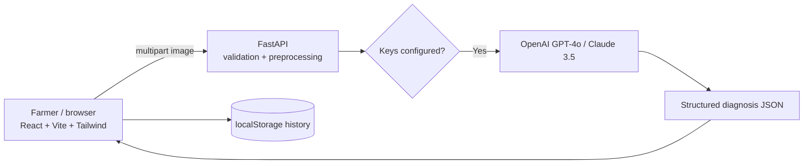

# AgriVision — AI Plant Health Assistant


> Upload a leaf image for an AI-generated visual assessment using a configured
> OpenAI or Anthropic provider. No diagnosis is generated when a provider is
> unavailable, and the application does not claim a calibrated confidence score.

This repository contains a React/Vite frontend and FastAPI backend. It is not a
complete farm-management platform. It now includes SQLite-backed accounts and
private crop records; weather, soil/pest logs, diagnosis/chat server sync, and
scheduled reminders are not implemented.

---

## Table of contents

- [Why this is useful](#why-this-is-useful)
- [Features](#features)
- [Screenshots](#screenshots)
- [Architecture](#architecture)
- [Quick start (AI provider required)](#quick-start-ai-provider-required)
- [Full setup (AI providers)](#full-setup-ai-providers)
- [Configuration](#configuration)
- [API reference](#api-reference)
- [Disease library](#disease-library)
- [Project structure](#project-structure)
- [Development](#development)
- [Testing](#testing)
- [Docker](#docker)
- [Accessibility & i18n](#accessibility--i18n)
- [Security](#security)
- [Roadmap](#roadmap)
- [Contributing](#contributing)
- [License](#license)

## Why this is useful

- Visual assessments can help organize observations and next steps.
- Low-friction: drag-drop photo, one tap analyze, printable/shareable report.
- Mobile-first responsive interface with dark mode and local history.

## Features

- **Image assessment** — drag-drop upload, inline validation, progress and
  explicit provider/configuration errors.
- **Two AI providers** — OpenAI GPT-4o and Anthropic Claude 3.5 Sonnet.
- **Agricultural AI chat** — provider-backed English, Kannada, Hindi, and
  Marathi responses; local searchable conversations; no fabricated offline
  chatbot replies.
- **Reports** — severity, symptoms, affected area (no uncalibrated confidence),
  treatment timeline, prevention calendar, copy/print/share.
- **History** — localStorage recent analyses with restore, export, clear.
- **Accounts and crop records** — password-hashed sign-in and per-user crop
  create/read/update/delete backed by SQLite.
- **Disease library** — 8 common diseases with symptoms and prevention.
- **Farmer-first UX** — mobile-first, keyboard accessible, reduced-motion safe,
  localized navigation and chat controls, toasts, empty/loading/error states.
- **Hardened API** — Pillow verification, size guards, rate limits, security
  headers, structured logging, health/version endpoints.

## Screenshots

> Place captures in `docs/screenshots/` (see `docs/SCREENSHOTS.md`).

| Home / upload | Analyzing | Report |
|---|---|---|
| `01-home.png` | `02-analyzing.png` | `03-report.png` |

## Architecture



See `docs/ARCHITECTURE.md` for request flow, limits, and failure modes.

## Quick start (AI provider required)

Configure at least one supported provider key in `backend/.env` before
requesting image analysis or chat. Missing keys result in an explicit service
unavailable response; the application does not generate sample diagnoses.

```bash
cd backend
python -m venv .venv
# Windows PowerShell:
# .\.venv\Scripts\Activate.ps1
# macOS/Linux:
source .venv/bin/activate
pip install -r requirements.txt
uvicorn app.main:app --reload --port 8000
```

Open http://localhost:8000/docs to inspect the API.

**Frontend:**

```bash
cd frontend
npm install
npm run dev
```

Open http://localhost:5173 and upload a real image. The current frontend
toolchain requires Node.js 20.19 or newer.

### Windows PowerShell setup

Open two PowerShell terminals in the project folder:

```powershell
# Terminal 1: backend (Python 3.11 recommended for the pinned dependencies)
Set-Location .\backend
py -3.11 -m venv .venv
.\.venv\Scripts\Activate.ps1
python -m pip install -e ".[dev]"
Copy-Item .env.example .env
uvicorn app.main:app --reload --port 8000
```

```powershell
# Terminal 2: frontend
Set-Location .\frontend
npm install
npm run dev
```

Set a valid provider key in `backend\.env` and restart the backend. Never put
provider keys in frontend environment variables.

## Full setup (AI providers)

```bash
cd backend
cp .env.example .env
# edit .env — add OPENAI_API_KEY and/or ANTHROPIC_API_KEY
uvicorn app.main:app --reload --port 8000

cd ../frontend
cp .env.example .env   # optional: VITE_API_BASE
npm install
npm run dev
```

Frontend API calls use `VITE_API_BASE` (default `/api/v1`). In dev, Vite
proxies API requests and the API docs/OpenAPI endpoints to
`http://localhost:8000` (see `frontend/vite.config.js`). Docker Compose uses
the frontend Nginx proxy to reach the `backend` service; Render sets the
frontend API base to the deployed backend URL in `render.yaml`.

## Deploy to Render

The root [`render.yaml`](./render.yaml) Blueprint defines a public static
frontend and a FastAPI backend. In the [Render Dashboard](https://dashboard.render.com/),
choose **New → Blueprint**, connect this GitHub repository, and apply the
Blueprint. Render will prompt for `OPENAI_API_KEY`; enter it only in Render's
secret-value prompt, never in GitHub or this file.

The backend uses a 1 GB persistent disk for SQLite account and crop records.
Render's static site is free, but the backend plan and persistent disk can
incur Render charges. OpenAI API usage is billed separately. The backend health
endpoint is `/api/v1/health`; the deployed website and API URLs are based on
the service names in `render.yaml`.

## Configuration

Backend (`backend/.env`):

```env
OPENAI_API_KEY=
ANTHROPIC_API_KEY=
DEFAULT_LLM_PROVIDER=openai
DEBUG=False
CORS_ORIGINS=http://localhost:5173,http://localhost:3000
RATE_LIMIT_PER_MINUTE=60
CHAT_RATE_LIMIT_PER_MINUTE=10
AUTH_RATE_LIMIT_PER_MINUTE=20
MAX_FILE_SIZE_MB=10
DATABASE_PATH=./agrivision.sqlite3
```

Frontend (`frontend/.env`):

```env
VITE_API_BASE=/api/v1
```

For a separately hosted frontend, set `VITE_API_BASE` to the backend's full
versioned API URL, such as `https://your-api.example.com/api/v1`. The footer's
API docs link uses that same backend configuration.

## API reference

Interactive docs: `http://localhost:8000/docs`.

| Method | Path | Description |
|---|---|---|
| `POST` | `/api/v1/detect` | Multipart `file` + `provider`, `include_treatment`, `include_prevention` |
| `GET` | `/api/v1/health` | `status`, `version`, `providers_available` |
| `GET` | `/api/v1/providers` | Configured provider availability |
| `GET` | `/api/v1/version` | Service name + version |
| `GET` | `/api/v1/diseases` | Curated library (8 entries) |
| `POST` | `/api/v1/feedback` | `{ detection_id, rating, comment }`; appends to local JSONL storage |
| `POST` | `/api/v1/auth/register` | Create an account and receive a bearer session |
| `POST` | `/api/v1/auth/login` | Verify credentials and issue an expiring session |
| `GET` | `/api/v1/auth/me` | Return the authenticated account |
| `POST` | `/api/v1/auth/logout` | Revoke the current session |
| `GET/POST` | `/api/v1/crops` | List or create the current user's crop records |
| `PUT/DELETE` | `/api/v1/crops/{crop_id}` | Update or delete a crop owned by the current user |

Example:

```bash
curl -X POST http://localhost:8000/api/v1/detect \
  -F "file=@leaf.jpg;type=image/jpeg" \
  -F "provider=openai" \
  -F "include_treatment=true" \
  -F "include_prevention=true"
```

See `docs/API_EXAMPLES.md` for responses and errors.

## Disease library

`GET /api/v1/diseases` + in-app **Library** tab: early/late blight, powdery
mildew, leaf spot, rust, mosaic virus, bacterial spot, healthy leaf — each
with symptoms, severity hints, and prevention.

## Project structure

```text
plant-disease-detector/
  backend/
    app/
      api/routes.py        # REST endpoints
      api/auth.py          # registration, sign-in, session revocation
      api/crops.py         # owner-scoped crop CRUD
      core/config.py       # env-driven settings
      models/schemas.py    # Pydantic contracts
      services/
        llm_vision.py      # OpenAI/Anthropic + safe parsing
        database.py        # SQLite schema and connection management
        image.py           # Pillow verify/normalize
        library.py         # curated disease data
      main.py              # app factory, middleware, lifespan
    tests/                 # pytest suite
    Dockerfile
    pyproject.toml
  frontend/
    src/
      components/          # Header, Hero, UploadZone, ResultDisplay, ...
      utils/api.js         # API client
      utils/history.js     # localStorage store
      locales/             # en/kn/hi/mr UI resources
      utils/i18n.js        # localized string lookup
      components/ChatAssistant.jsx # provider-backed chat + local history
      styles/index.css     # design system
      App.jsx              # tab state machine
    index.html             # SEO/PWA/meta
  docs/                    # architecture, e2e, screenshots
  .github/workflows/ci.yml
```

## Development

```bash
# backend
cd backend
pip install -e ".[dev]"
ruff check app tests
pytest -q

# frontend
cd frontend
npm run lint
npm run build
```

## Testing

- Backend: `pytest -q` (validation, auth/session lifecycle, crop CRUD and ownership, library, feedback, health).
- Frontend: `npm run lint && npm run build`; manual checklist in
  `docs/E2E_CHECKLIST.md`.
- CI runs both on push/PR (see `.github/workflows/ci.yml`).

## Docker

```bash
docker build -t plant-detector ./backend
docker run -p 8000:8000 --env-file backend/.env plant-detector

# or full stack
docker compose up --build
```

Docker Compose stores the SQLite database in the named `agrivision_data`
volume. Back it up with the backend stopped, and do not commit the database
file. For local PowerShell runs, the default database is
`backend\agrivision.sqlite3`; set `DATABASE_PATH` in `backend\.env` to override.
The backend applies versioned schema migrations automatically at startup; the
current schema is migration 1. To initialize it explicitly:

```powershell
Set-Location .\backend
python -c "from app.services.database import initialize_database; initialize_database()"
```

## Accessibility & i18n

- Keyboard-first, focus-visible rings, ARIA live regions for progress/toasts.
- `prefers-reduced-motion` disables non-essential animation; contrast-checked
  severity badges; 44px touch targets.
- English, Kannada, Hindi, and Marathi resource files in `frontend/src/locales/`;
  language choice persists in the browser.
- Localization currently covers navigation and chat controls; much of the
  original analyzer, library, and help content remains English.
- Chat requests and assistant responses are sent to the configured backend
  provider. Conversation history remains in browser localStorage.

## Security

- Never commit `.env`. Keys stay server-side; frontend never sees them.
- Passwords use scrypt hashes; opaque bearer tokens are stored hashed in
  SQLite, expire after 14 days, and are kept in browser `sessionStorage`.
- Registration and sign-in have an in-process per-IP request limit. Use an
  upstream shared limiter when deploying multiple backend workers.
- Chat is unavailable until an OpenAI or Anthropic key is configured; it does
  not return canned or demo answers.
- Size/MIME/Pillow verification, rate limiting, security headers, CORS
  allowlist. See `SECURITY.md` for reporting.

> AI image analysis is not a validated diagnostic model or a confirmed
> diagnosis. Confirm treatment with a local extension officer.

## Current scope and service requirements

- Disease analysis uses configured OpenAI/Anthropic vision. Missing
  configuration or provider failure is returned as an error; no synthetic
  diagnosis is substituted. Provider-generated assessments are not calibrated
  model predictions, so confidence scores are not displayed.
- Agricultural chat uses the configured provider and selected UI language.
  Add `OPENAI_API_KEY` or `ANTHROPIC_API_KEY` to `backend/.env`; restart the
  backend. Chat messages may be sent to that provider for completion.
- Crop records are database-backed and scoped to the signed-in user. Chat and
  diagnosis history remain browser-local and are not synced to accounts.
- No local model weights, configured AI credentials, password-recovery email
  service, weather provider, verified retrieval corpus, soil/pest records, or
  reminders were present. Those features are not represented as working
  services.

## Roadmap

- [x] Provider-backed vision/chat, explicit provider errors, local history
- [x] SQLite accounts, expiring sessions, and owner-scoped crop records
- [ ] Field pilot + feedback learning loop
- [ ] PWA offline capture + background sync
- [ ] Regional language expansion + voice input

## Contributing

See `CONTRIBUTING.md`. Run `pytest -q` and `npm run lint` before PRs.

## License

MIT — see [LICENSE](./LICENSE) and [NOTICE](./NOTICE).
Built with care by [kv-creates](https://github.com/kv-creates).
