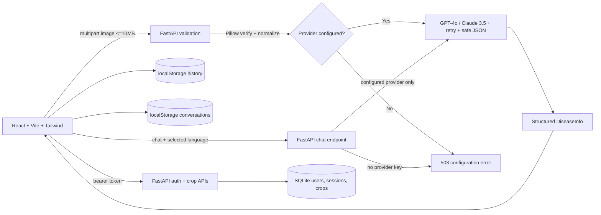

# Architecture

## Key decisions

- Pillow is source of truth for images; `python-magic` optional (Windows-safe).
- Detection, chat, and authentication rate limits are in-process; use a shared
  limiter at the ingress for multi-replica deployments.
- Provider failures are surfaced as errors; the application does not fabricate
  diagnoses or calibrated confidence scores.
- History never leaves the browser; feedback is appended to a local JSONL file.
- Chat requests require an explicitly configured provider. Conversation history
  remains in browser localStorage.
- Passwords are stored as scrypt hashes. Opaque, expiring bearer tokens are
  stored as SHA-256 digests; crop queries always include the authenticated
  owner ID.
- SQLite schema migration version 1 is applied automatically at startup.
- No local model weights, password-recovery service, weather API, or verified
  retrieval corpus are included in this extracted project.
